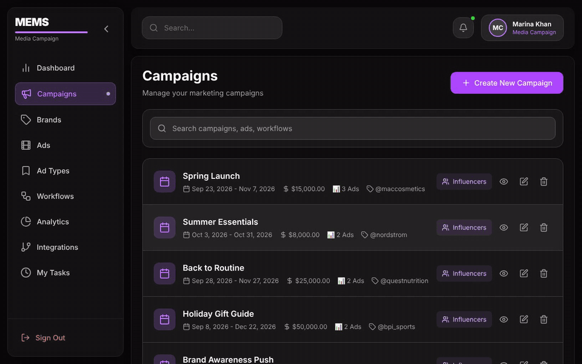
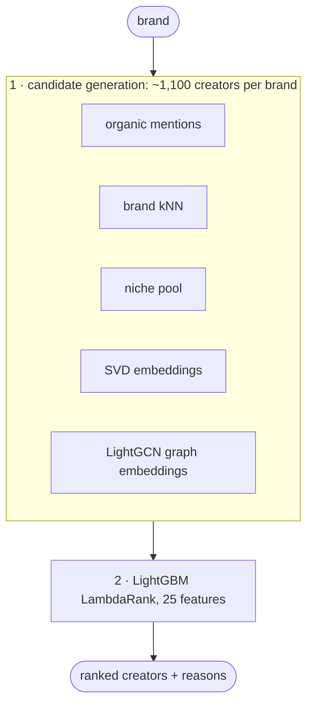
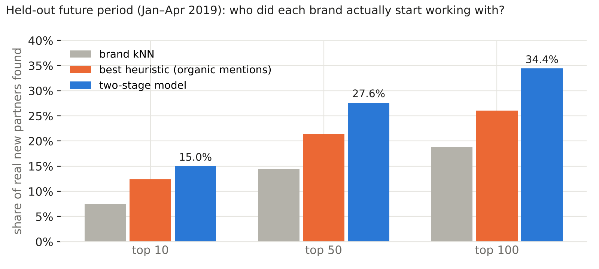
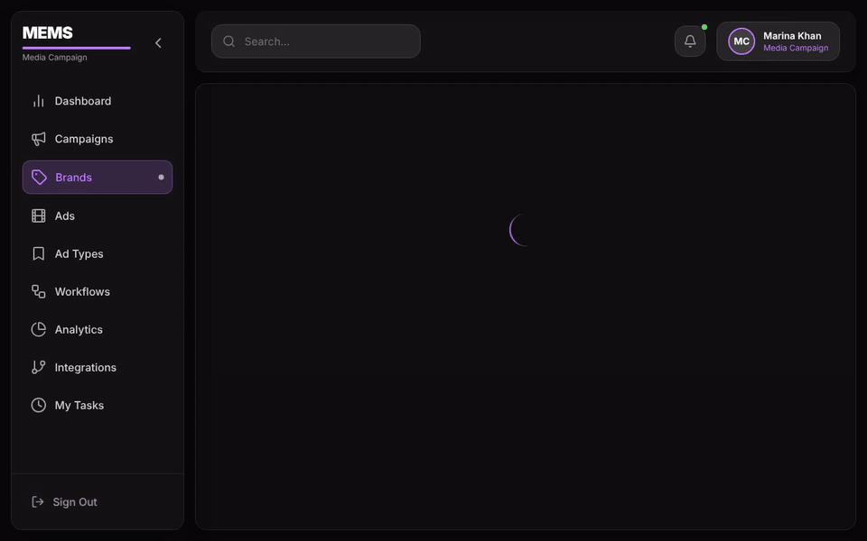
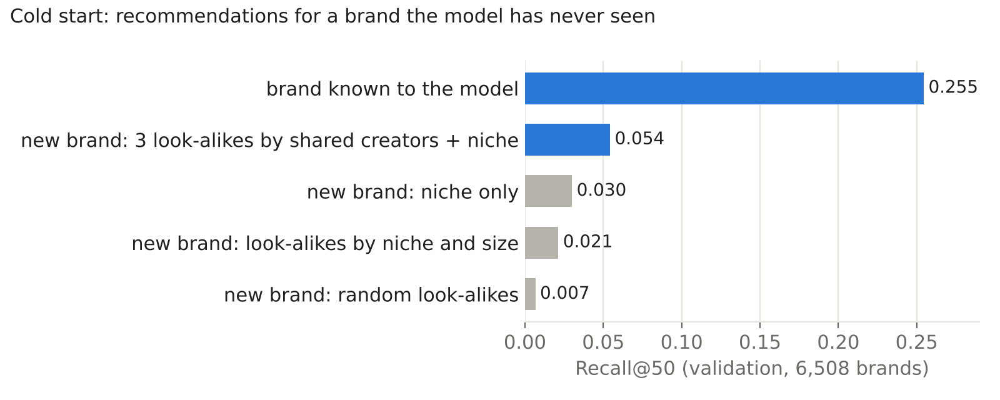
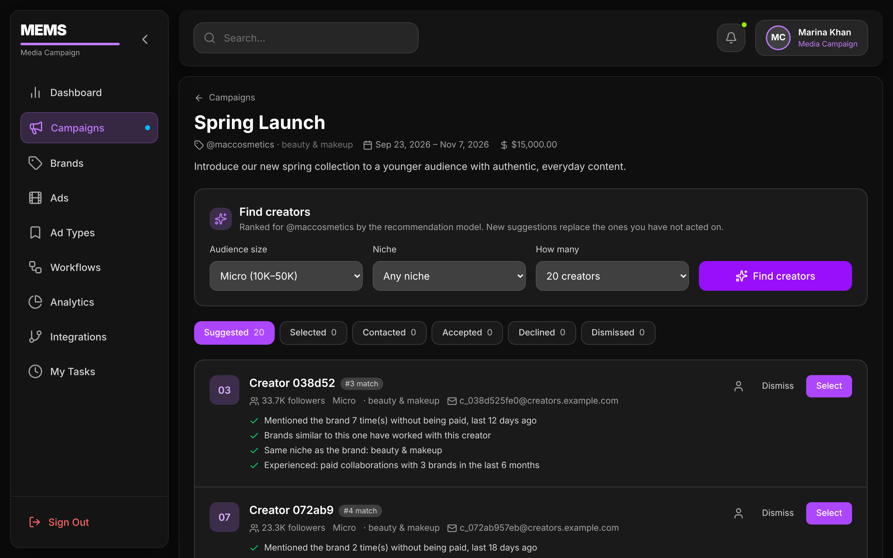
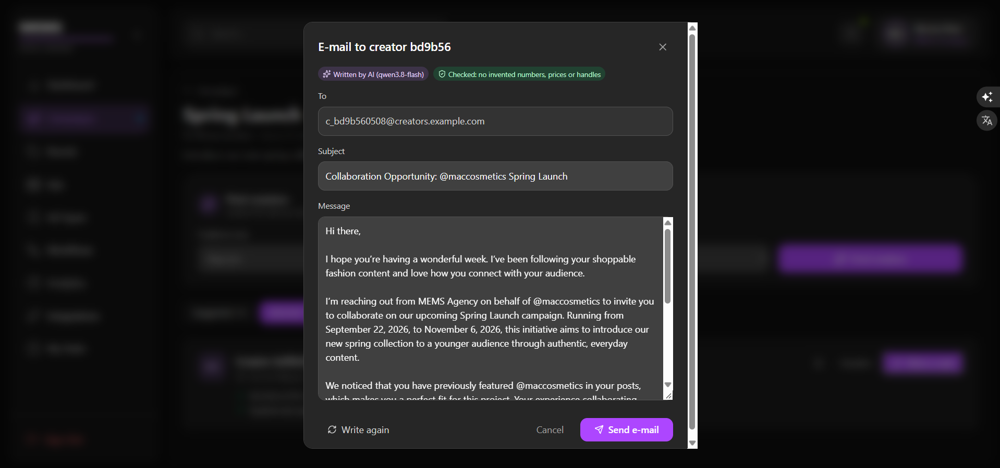
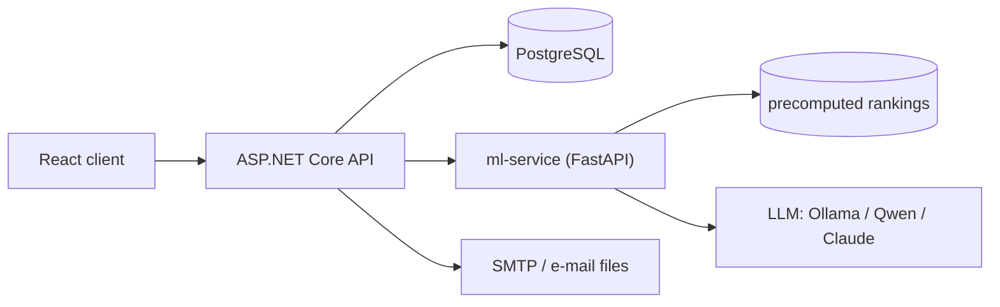

# MEMS: AI influencer matching for marketing campaigns

A full-stack marketing app where an agency plans campaigns for client brands, and **machine learning picks the
Instagram creators a brand should work with, explains why, and drafts the outreach e-mail**.



The app is a complete product (campaigns, budgets, ads, tasks and approvals, brands, influencer outreach, e-mail),
built with **ASP.NET Core, React and PostgreSQL**. This README focuses on the **machine-learning part**: how the
recommender was framed, built, evaluated and taken apart, and how it is served to the app.

**At a glance**

* **Two-stage recommender**: five candidate sources (including a **LightGCN** graph neural network) and a
  **LightGBM LambdaRank** ranker, trained on 1.6M real Instagram posts.
* On a held-out future period it finds **27.6% of each brand's real new partners in its top 50, +29% over the
  best heuristic**, and the gain holds in every walk-forward fold.
* **Error analysis, ablation and two experiments that did not work**, all measured and logged, not hidden.
* **Cold start**: new client brands get suggestions from similar brands, with a simulation of how good they are.
* **LLM outreach e-mails with guardrails**: the model only rewrites known facts, and every draft is checked by code.
* Served by a **FastAPI** microservice, consumed by the .NET API, shown in a React UI; runs with `docker compose up`.

---

## The problem

A brand wants to start paid collaborations with creators who fit it. There are ~35,000 creators in the data, and
the brand's marketing manager can contact a few dozen. **Which ones?**

I framed it as a **ranking problem with a time split**: given everything that happened before a cutoff date, rank
creators for each brand, then check which creators actually started a *new* paid collaboration with that brand
after the cutoff. This mirrors real use (you only know the past) and avoids the most common mistake in
recommender projects: random train/test splits that leak the future into training.
→ [`ml/src/mlrec/split.py`](ml/src/mlrec/split.py)

## The data

**Influencer and Brand Dataset** (Kim, Jiang and Wang, WSDM 2021), shared by its authors for research on request.
It is not included in this repository.

| what | how much |
|---|---|
| posts | 1,601,074 Instagram posts that mention a brand (JSON metadata; images not used) |
| creators | 38,113 (median 14.6K followers) |
| brands | 26,910 mentioned; 25,282 brand profiles |
| period | mostly March 2017 – April 2019 (90% of posts) |
| sponsorship | 13.8% of posts are sponsored (branded-content tag or #ad-style hashtags) |
| interactions | 783K brand–creator pairs, of which 150K are paid collaborations |

What I derived from it ([`ml/src/mlrec/data.py`](ml/src/mlrec/data.py), [notebook 01](ml/notebooks/01_data_exploration.ipynb)):
**interactions** (a creator mentions a brand, organically or paid), **engagement relative to the creator's own
history** (raw likes mostly measure follower count), and **content niches** learned from hashtags with NMF
([`niches.py`](ml/src/mlrec/niches.py)), because Instagram's own categories say little.

**Privacy.** Names, captions, bios, e-mails, phone numbers and URLs are dropped at extraction; creators are
identified by a salted hash (`c_3f2a…`) whose salt never leaves the data folder. Profile bios are reduced to
keyword counts per niche ([`extract_bio_niches.py`](ml/scripts/extract_bio_niches.py)), never stored as text.
In the app, creators get e-mail addresses on the reserved domain `creators.example.com`, so no real person can
ever be contacted.

## How the recommender works



* **Stage 1, candidate generation** shrinks 35K creators to ~1,100 plausible ones per brand from five sources:
  creators who already mention the brand without being paid, creators of similar brands (item kNN), active creators
  of the brand's niche, and two embedding models of the brand–creator graph: truncated **SVD** and **LightGCN**,
  a graph neural network implemented in PyTorch.
  → [`candidates.py`](ml/src/mlrec/candidates.py), [`lightgcn.py`](ml/src/mlrec/lightgcn.py)
* **Stage 2, ranking**: a **LightGBM LambdaRank** model orders the candidates using 25 features: how recently and
  how often the creator mentioned the brand, graph scores, niche fit, the creator's size, activity and paid
  experience, and the sizes this brand usually works with.
  → [`features.py`](ml/src/mlrec/features.py), [`ranker.py`](ml/src/mlrec/ranker.py)

Baselines came first ([notebook 02](ml/notebooks/02_baselines.ipynb)): a simple "organic mentions" heuristic turned
out to be hard to beat, so every later model had to justify itself against it.

## Results



| model (test: Jan–Apr 2019, evaluated once) | Recall@10 | Recall@50 | Recall@100 | NDCG@50 |
|---|---|---|---|---|
| brand kNN | 0.075 | 0.145 | 0.188 | 0.070 |
| heuristic: organic mentions | 0.124 | 0.214 | 0.261 | 0.113 |
| **two-stage model** | **0.150** | **0.276** | **0.344** | **0.142** |

*Recall@50 = the share of a brand's real future partners that appear in its top 50, averaged over brands.*

* Model choices were made on a validation window; the **test window was used once**, at the end.
* **Walk-forward validation** (the same setup shifted back in time) gives +21% and +23% over the heuristic, so the
  test gain is not a lucky period. → [`walk_forward.py`](ml/scripts/walk_forward.py)
* **LightGCN** was the biggest single improvement, mostly for brands with little history.
* Every experiment, including the rejected ones, with its numbers: [`ml/EXPERIMENTS.md`](ml/EXPERIMENTS.md),
  tracked in MLflow. The full story is in [notebook 03](ml/notebooks/03_ranker.ipynb).

## What did not work, and what that taught me

The most useful part of the project. → [notebook 04](ml/notebooks/04_error_analysis.ipynb)

* **Error analysis.** Half of the real partners never reach the ranker. I wrote down my guesses first (new
  creators? small creators?), read 50 misses by hand and grouped all 14K by cause. My first guess explained under
  5% of misses. Reading rows found what counts did not: brands outside fashion and beauty get nonsensical niches
  (a protein bar labelled "fast fashion").
* **A big group is not a big cause.** Most misses are "creator from another niche", but so are most *hits*:
  brands simply work across niches (only 27–43% of new partners share the brand's niche).
* **Experiment R9, niche affinity** (creator niche mixes from hashtags and bios, brand affinities learned from past
  partners): +1.1 points of candidate recall, **no change in Recall@50**. Not adopted.
* **Ablation A2, removing niches entirely:** same Recall@50 with 18% fewer candidates. Niches help *people*
  (filters, explanations) far more than they help *ranking*; the graph models already carry that signal.

## Cold start: brands the model has never seen

A new client is added in the app and named after up to five similar brands the model knows. Their ranked lists
and the brand's niche are merged with **reciprocal rank fusion** (each creator scores 1 / (60 + rank) per list).



To know how good that is, a simulation pretends every validation brand is new:



Fusion works (8× random), but cold start costs ~80% of the quality, and look-alikes chosen by surface traits
(niche, size) are no better than the niche alone: **who a brand resembles in behaviour matters more than what it
looks like**. The app says so to the user. → [`cold_start_simulation.py`](ml/scripts/cold_start_simulation.py)

## From model to product

**Offline batch scoring.** The final model is retrained on the most recent data and ranks the top 300 creators for
each of the 300 brands the app knows, with human-readable **reasons** taken from the features
("mentioned the brand 7 times without being paid", "brands similar to this one have worked with this creator").
The service only filters and pages those lists, so every request is fast and deterministic.
→ [`export_service.py`](ml/scripts/export_service.py), [`ml-service/app/store.py`](ml-service/app/store.py)



**LLM outreach e-mails with guardrails.** An LLM (Ollama locally, or any OpenAI-compatible API such as Qwen, or
Claude) turns facts the app holds into a short collaboration offer. It is **grounded**: it only sees the brand,
campaign brief, the creator's niche and past collaborations and why they were recommended. Every draft then
passes **deterministic checks** in code: no numbers, money words or @handles that are not in the facts, no
placeholders, brand and campaign named. A failing draft gets one retry with the list of problems; after that, or
when no model is reachable, a template is used and the UI says so. The manager always reviews before sending.
→ [`ml-service/app/outreach.py`](ml-service/app/outreach.py), [`llm.py`](ml-service/app/llm.py)



## The full-stack app

| layer | built with |
|---|---|
| **Front end** | React 19, TypeScript, Vite, Tailwind: campaigns, brands (with the add-brand flow), influencer workflow (suggest → select → AI e-mail → send → accepted/declined), ads, ad types, workflows and approvals, tasks, dashboard |
| **API** | ASP.NET Core 8, Entity Framework Core, PostgreSQL, ASP.NET Identity; migrations and seeding at start-up; typed HTTP client to the ML service; SMTP or file e-mail delivery |
| **ML service** | Python, FastAPI, pandas; 20 tests with synthetic data and a fake LLM |
| **ML research** | pandas, scikit-learn, PyTorch (LightGCN), LightGBM, MLflow, Jupyter |

Where to look in the app code:
[`InfluencerService.cs`](MusicEventManagementSystem/MusicEventManagementSystem.API/Services/Marketing/InfluencerService.cs)
(the outreach workflow and cold-start fallback),
[`MlServiceClient.cs`](MusicEventManagementSystem/MusicEventManagementSystem.API/Services/Marketing/MlServiceClient.cs)
(the API never knows the model runs in Python),
[`CampaignInfluencers.tsx`](MusicEventManagementSystem/MusicEventManagementSystem.Client/src/frontend/media-campaign/pages/CampaignInfluencers.tsx)
(the influencer UI).



## Repository map

| folder | what is in it |
|---|---|
| [`ml/`](ml) | research code: [`src/mlrec`](ml/src/mlrec) (library), [`scripts`](ml/scripts) (experiments, export), [`notebooks`](ml/notebooks) (the story with results), [`EXPERIMENTS.md`](ml/EXPERIMENTS.md) |
| [`ml-service/`](ml-service) | FastAPI service: recommendations, look-alikes, outreach drafts ([README](ml-service/README.md)) |
| [`MusicEventManagementSystem/…API`](MusicEventManagementSystem/MusicEventManagementSystem.API) | .NET API |
| [`MusicEventManagementSystem/…Client`](MusicEventManagementSystem/MusicEventManagementSystem.Client) | React client |
| [`docs/`](docs) | images for this README ([`make_figures.py`](docs/make_figures.py) redraws the charts from `ml/results`) |

## Running it

The model data (`ml-service/data/`, four files) is not in git because it is derived from the dataset. Create it
with `python ml/scripts/export_service.py` (needs the dataset, ~40 min).

**With Docker** (PostgreSQL, API, client, ML service and a test mail server):

```bash
docker compose up --build
```

Open http://localhost:5173 and register an account. Sent e-mails appear in the Mailpit inbox at
http://localhost:8025, the API docs are at http://localhost:5255/swagger. For AI-written e-mails, run Ollama on
your computer (`ollama pull qwen2.5:7b`) or put an API key in `ml-service/.env` (see
[`.env.example`](ml-service/.env.example)); without one, e-mails use the template.

**For development** (VS Code): PostgreSQL running locally, then *Run and Debug* → **MEMS: API + Client + ML
service**. Details in [`ml-service/README.md`](ml-service/README.md).

## Limitations and next steps

* **Offline evaluation only.** Whether recommended creators actually say yes needs real outreach. The app already
  records selected, dismissed, accepted and declined creators: the labels a future model and an A/B test need.
* **Implicit feedback.** The data shows who worked with whom, never who was considered and rejected.
* **Half of the partners are never retrieved**, and the error analysis suggests much of the signal (agency
  relationships, gifting lists, outreach by creators) is not in public posts.
* **Data from 2017–2019.** Methods transfer; the trained model and trends do not.

## Origin and credits

MEMS started as a team project (a music event management system with ticket sales, event, artist and
media-campaign modules). I took the media-campaign module, turned it into a marketing agency tool and built the
ML system, the ML service and the influencer features on top; the other modules remain in the code base but are
not routed in this version.

Dataset: S. Kim, J.-Y. Jiang, W. Wang. *Discovering Undisclosed Paid Partnership on Social Media via
Aspect-Attentive Sponsored Post Learning.* WSDM 2021.

```bibtex
@inproceedings{kim2021discovering,
  title={Discovering Undisclosed Paid Partnership on Social Media via Aspect-Attentive Sponsored Post Learning},
  author={Kim, Seungbae and Jiang, Jyun-Yu and Wang, Wei},
  booktitle={Proceedings of the 14th ACM International Conference on Web Search and Data Mining},
  pages={319--327},
  year={2021}
}
```
